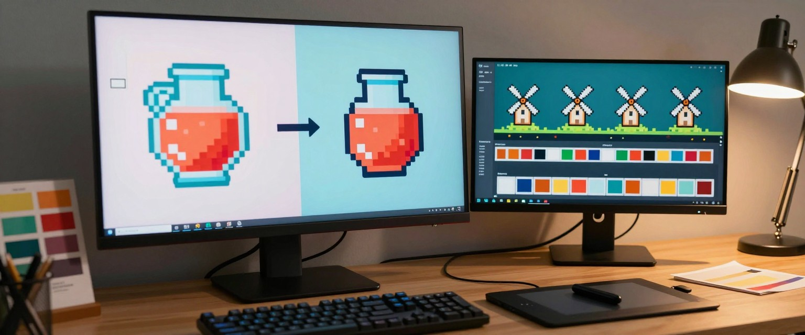

# pixelwright

Pixel art an AI agent can make and animate without guessing. Code makes the pixels, exact gates prove them, and a
human picks on a click page. Formerly **spritewright**, which did the animation half.

- **Make.** An image model paints something that looks like pixel art: thousands of colours, a block size that
  wanders, soft edges, a background. `pxw.py make` snaps it to its true grid (scale and offset found, fractional
  scales too, one pixel per block by mode), clears the background, locks the colours to a palette (PICO-8, a
  `.hex` or `.gpl` file, or every colour of the sprites it must sit beside), fixes stray pixels and doubled
  outlines, adds a selective outline, crops to a power of two or an engine size, and makes tiles wrap.
- **Animate.** Describe what moves (a furnace that flares, a drill that plunges, a building that rises and powers
  on); the frames are made in code from the still, inside region masks. The rest frame equals the still byte for
  byte, nothing outside the regions changes, and every colour comes from the still's palette.
- **Gated.** Make: palette, budget, binary alpha, size, tile seam. Animate: rest frame, outside-mask changes,
  alpha, new colours, a "noticeable" floor, the loop seam. Both run artwright's `aw.py pixel` when it is installed.
- **Small.** One Python script, numpy and Pillow, no model weights, no network calls.

| Skill | Job |
|---|---|
| [pixelwright](skills/pixelwright/SKILL.md) | the hub: routes, and holds `scripts/pxw.py` |
| [pixelwright-make](skills/pixelwright-make/SKILL.md) | a render or drawing becomes real pixel art |
| [pixelwright-animate](skills/pixelwright-animate/SKILL.md) | an existing still moves; sheets, previews, review page |

Rendering a new still is a generator's job (ComfyUI, PixelLab); judging pixel art is artwright-pixel's. pixelwright
sits between them and does not rebuild either.

## Install

Claude Code:

```
claude plugin marketplace add m4bwav/pixelwright
claude plugin install pixelwright@pixelwright
```

Other agents (Copilot, Codex, Cursor, Gemini CLI): point them at the `skills/` folder. Python 3.9+ with numpy and
Pillow:

```
python -m pip install numpy pillow
python skills/pixelwright/scripts/pxw.py doctor
```

## Quick start

Make:

```
python pxw.py snap render.png snapped.png              # what grid is in this render?
python pxw.py make recipe.json out                     # snap, background, palette, clean, crop, gates
python pxw.py palette sprite.png q.png --palette pico-8 --gpl pico.gpl
python pxw.py tile grass.png grass-tile.png            # wrap the edges with no new colours
```

A recipe:

```json
{"id": "potion", "input": "render.png", "palette": "from:chest.png,key.png",
 "clean": {"orphans": true, "outline": "selective"}, "crop": {"pad": 1, "size": "32x32"}}
```

Animate:

```
python pxw.py grid machine.png grid.png                # read coordinates off the still
python pxw.py mask brief.json mask.png                 # check the regions
python pxw.py frames brief.json out --root .           # sheets, previews, gates.json
python pxw.py review batch --port 8765                 # click page, picks.json
```

Recipe schema: [skills/pixelwright-make/references/recipe.md](skills/pixelwright-make/references/recipe.md).
Brief schema: [skills/pixelwright-animate/references/brief.md](skills/pixelwright-animate/references/brief.md).

## Coming from spritewright

Same briefs, same sheets, same gates files; the animation output is byte for byte the same. The CLI is now
`skills/pixelwright/scripts/pxw.py`. `skills/pixelwright-animate/scripts/sw.py` still runs for one release and
calls `pxw.py`; `SPRITEWRIGHT_AW` is still read beside `PIXELWRIGHT_AW`. Uninstall the old plugin
(`claude plugin uninstall spritewright@<marketplace>`) and install pixelwright.

## Choices made

Built-in palettes: PICO-8 only (CC0); every other palette comes from a file, since Lospec palettes carry their own
licences. Dithering is ordered (Bayer) only and off by default; `"space": "linear"` keeps each area's light. Grid detection is pixelwright's own (phase
coherence over edge positions), so it works without artwright; artwright's checks are called, never copied.

## Development

`python tests/test_pxw.py` (animation), `python tests/test_make.py` (make), both offline with fixtures drawn in
code, and `python tests/check_skills.py`. CI runs them on Windows, macOS and Linux. Rules for agents:
[AGENTS.md](AGENTS.md).

## Maintenance

An evergreen unit: research in [RESEARCH.md](RESEARCH.md), changes in [CHANGELOG.md](CHANGELOG.md), lessons in
[LEARNINGS.md](LEARNINGS.md), test runs in [TESTS.md](TESTS.md), schedule in `evergreen.json`, procedure in
[MAINTENANCE.md](MAINTENANCE.md).

## License

MIT. See [LICENSE](LICENSE). Security: [SECURITY.md](SECURITY.md).
